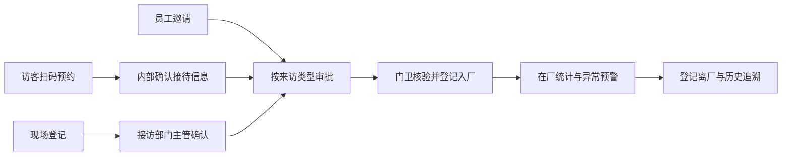

# KS-VMS · 厂区访客管理系统

KS-VMS 是基于 Java 21、Spring Boot 和 Vue 3 的厂区访客管理系统，支持扫码预约、员工邀请、分类审批、门岗核验、车辆登记与进出厂追溯，并提供在厂统计、滞留预警、黑名单及多角色权限管理，适用于企业多厂区的访客接待与安全管理。

访客通过手机网页提交来访申请，企业员工在工作台完成接待确认、审批和门岗登记。系统围绕一次来访记录保存申请、审批、进出厂和异常处置过程，方便行政、门卫与安全人员协作处理。

[核心功能](#核心功能) · [技术栈](#技术栈) · [快速开始](#快速开始) · [部署配置](#部署配置) · [需求文档](docs/visitor-management-requirements.md) · [开发设计](docs/visitor-management-design.md)

## 核心功能

| 模块 | 功能 |
| --- | --- |
| 访客预约 | 扫码打开预约表，填写联系方式、公司、来访类型、日期和事由，查看进度、修改或撤销申请 |
| 员工邀请 | 生成访客专属邀请链接，预填来访信息，跟进领取与审批情况 |
| 分类审批 | 按来访类型分配审批岗位，支持现场来访主管确认、施工双部门审批和有时限的代班授权 |
| 智慧门岗 | 扫码入厂、扫码离厂、现场登记、车辆登记、身份核验和在厂人员查询 |
| 二维码管理 | 按厂区生成预约码或门岗现场登记码，支持预览、下载、复制链接及启停 |
| 安全管理 | 黑名单拦截、超时滞留及核验异常预警、访问区域、安全须知、补录与更正审核 |
| 数据统计 | 统计进出厂、当前在厂及滞留人数，按人员类型、部门和车辆查询，导出 CSV |
| 系统管理 | 管理账号、部门、角色、厂区和门岗，配置预约时段、停留上限及授权范围，查询操作日志 |

自助预约可直接填写，手机号用于联系，被访人员为选填姓名。门岗或行政在内部确认接访部门与适用区域后，申请进入对应岗位的审批。访客在提交时使用的浏览器中查看预约并领取通行码。

门岗工作台提供「扫码入厂」「扫码离厂」「现场登记」「车辆登记」四个主要入口。司机登记按送货或提货展示对应单号，来访记录将姓名、来访类型、公司、被访人员、时间和状态分别展示，便于快速核对。

## 业务流程



| 来访类型 | 审批岗位 | 业务信息 |
| --- | --- | --- |
| 客户 | 老板或授权代理 | 接待信息、访问区域 |
| 供应商 | 采购部门 | 来访事由 |
| 送货司机 | 仓库或采购部门 | 车牌、送货单号 |
| 物流司机 | 物流部门 | 车牌、提货单号 |
| 外协施工人员 | 负责部门 → 安全部门 | 安全培训、施工许可、作业区域 |
| 设备维修人员 | 设备部门 | 维修工单、作业区域 |
| 面试人员 | 人事部门 | 面试时间 |
| 软件维护人员 | 信息化部门 | 维护工单或变更单号、维护时段、作业区域 |

现场来访统一先经接访部门主管确认，再完成对应类型的审批。外协施工的负责部门与安全审批由不同人员处理。

系统按一人一申请、一次访问一进一出管理，支持同厂区内跨门岗登记离厂。普通流程中的驾驶人与车辆同步登记进出，特殊情况通过内部核实、补录和更正保留追溯记录。

## 技术栈

| 层次 | 技术 |
| --- | --- |
| 后端 | Java 21、Spring Boot 3.5、Spring Security、MyBatis-Plus |
| 前端 | Vue 3、Vite、Element Plus、Vant、Lucide |
| 数据与迁移 | MySQL 8.4、Flyway |
| 二维码 | ZXing、ZXing Browser |
| 任务与图表 | Spring Task、ECharts |
| 接口文档 | OpenAPI、Knife4j |
| 部署 | Docker Compose、Nginx、HTTPS |

后端采用模块化单体结构。访客端和员工工作台通过独立域名访问同一业务服务，Spring Security 校验账号权限与数据范围。通行核验使用数据库事务、唯一约束与幂等请求处理重复操作。

## 项目结构

```text
KS-VMS/
├── backend/
│   ├── src/main/java/cn/ks/vms/    后端业务与接口
│   ├── src/main/resources/        应用配置与数据库迁移
│   ├── src/test/                  业务规则与接口联调测试
│   └── Dockerfile
├── frontend/
│   ├── src/                      访客页面与员工工作台
│   └── vite.config.js
├── deploy/                       Nginx 配置与前端镜像
├── docs/                         需求及开发设计
├── .env.example                  部署变量示例
└── compose.yaml
```

## 快速开始

准备 Java 21、Maven 3.6.3 或更高版本、Node.js 22.12 或更高版本，以及 Docker。以下命令在项目根目录执行。

### 1. 启动本地数据库

```bash
docker run -d --name ks-vms-dev-db \
  -p 127.0.0.1:33317:3306 \
  -e MYSQL_RANDOM_ROOT_PASSWORD=yes \
  -e MYSQL_DATABASE=ks_vms \
  -e MYSQL_USER=vms \
  -e MYSQL_PASSWORD=ks-vms-local-db \
  mysql:8.4
```

等待 MySQL 就绪后启动后端。Flyway 自动应用数据库迁移，演示模式在空数据库中初始化厂区、门岗、须知及体验账号。

### 2. 启动后端

```bash
VMS_DEMO=true \
SECURE_COOKIES=false \
API_DOCS=true \
DB_PASSWORD=ks-vms-local-db \
VMS_VISITOR_URL=http://127.0.0.1:5173 \
  mvn -f backend/pom.xml spring-boot:run
```

默认后端地址为 `http://127.0.0.1:8080`。

### 3. 启动前端

在另一个终端执行以下命令。

```bash
npm --prefix frontend ci
npm --prefix frontend run dev
```

| 本地入口 | 用途 |
| --- | --- |
| [员工工作台](http://127.0.0.1:5173/) | 预约记录、审批、安全及系统管理 |
| [智慧门岗](http://127.0.0.1:5173/#gate) | 门卫扫码核验与登记 |
| [二维码管理](http://127.0.0.1:5173/#qr) | 生成、下载和管理登记二维码 |
| [访客预约](http://127.0.0.1:5173/visitor?register=company) | 访客直接填写预约表 |
| [现场登记](http://127.0.0.1:5173/visitor?register=east-gate) | 东门现场来访登记 |

本地二维码使用本机地址。手机扫码访问时，将 `VMS_VISITOR_URL` 配置为手机可访问的访客站点地址。

### 演示账号

以下账号由演示模式初始化，统一密码为 `KS-VMS-demo-2026`。体验时使用虚构访客与证件资料。

| 账号 | 用途 |
| --- | --- |
| `admin` | 管理配置、查看预约记录与统计 |
| `guard` | 门岗核验、现场登记、车辆登记、确认接待信息 |
| `approver` | 主管及各业务岗位审批 |
| `safety` | 安全审核、名单、预警与更正审核 |
| `employee` | 发出访客邀请 |

员工邀请通过受邀手机号领取，演示模式会在页面显示验证码。体验员工与访客流程时，可使用不同的浏览器配置文件。

## 部署配置

生产部署使用两个 HTTPS 域名，分别供访客和员工访问。先将 [环境变量示例](.env.example) 复制为 `.env`。

```bash
cp .env.example .env
```

| 配置项 | 用途 |
| --- | --- |
| `VMS_STAFF_HOST` | 员工工作台域名 |
| `VMS_VISITOR_HOST` | 访客站点域名，用于生成预约及邀请链接 |
| `DB_PASSWORD`、`MYSQL_ROOT_PASSWORD` | 数据库业务账号及管理员密码 |
| `VMS_SECRET` | 至少 32 个随机字符，用于数据加密和带密钥摘要 |
| `VMS_ADMIN_PASSWORD` | 首次创建的管理员密码 |
| `VMS_ADMIN_TOTP` | 管理员验证器密钥，使用 32 至 64 个 Base32 字符 |
| `VMS_SMS_URL`、`VMS_SMS_TOKEN` | 员工邀请手机号核验所用的短信交付地址和访问令牌 |

将域名证书和私钥放入 `deploy/certs/`，文件名分别为 `staff.crt`、`staff.key`、`visitor.crt`、`visitor.key`。完成变量、证书和域名解析配置后，构建并启动服务。

```bash
mvn -f backend/pom.xml package
npm --prefix frontend ci
npm --prefix frontend run build
docker compose up -d --build
```

Docker 将后端构建产物与前端静态文件装入镜像，并使用命名卷保存 MySQL 数据。首次登录使用 `admin` 账号、配置的管理员密码及验证器生成的验证码。在工作台配置真实厂区、门岗、部门、账号与审批授权，发布须知，再生成访客登记二维码。

管理、行政、安全及导出账号启用验证器认证。短信交付服务接受带 Bearer 令牌的 HTTPS POST，JSON 字段为 `phone`、`code` 和 `expiresInSeconds`，接收请求成功后返回 2xx。

数据库备份应配套保存对应的 `VMS_SECRET`。启用正式站点前，使用实际手机、门岗终端和扫码设备验收登记及进出厂流程。

## 测试与构建

```bash
mvn -f backend/pom.xml test
npm --prefix frontend run build
```

对已启动的演示服务执行接口联调。

```bash
VMS_TEST_URL=http://127.0.0.1:8080 mvn -f backend/pom.xml test
```

联调测试会写入虚构的访客、预约和安全记录，覆盖免验证码预约、访客数据权限、内部接待确认、现场审批、二维码启停、重复核验、跨门岗离厂及历史导出。

## 项目文档

- [需求文档与验收场景](docs/visitor-management-requirements.md)
- [架构与开发设计](docs/visitor-management-design.md)
