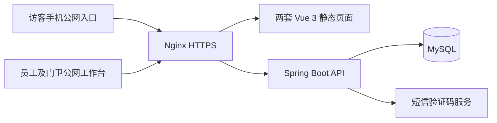

# 入厂登记管理系统开发设计

配套文档 [需求与验收](visitor-management-requirements.md)

## 1. 技术选型与部署结构

| 层次 | 选型及用途 |
| --- | --- |
| 服务端 | Java 21、Spring Boot、Spring Security、MyBatis-Plus。按业务模块组织的单体应用 |
| 访客端 | Vue 3、Vant。手机扫码打开登记、邀约、预约详情和通行码页面 |
| 员工工作台 | Vue 3、Element Plus。含独立布局的门岗首页，统计图表使用 ECharts |
| 数据与任务 | MySQL 作为业务数据来源，Spring Task 扫描逾期和预警。Redis 按需用于多实例会话和限流 |
| 二维码 | 服务端使用 ZXing 生成，门岗网页使用 ZXing 的浏览器解码组件。支持摄像头权限提示、扫码枪输入或人工检索 |
| 接口文档 | OpenAPI、Knife4j。测试环境提供调试页面，生产环境配置独立访问授权 |
| 部署与版本 | Nginx、Docker Compose、Git。以版本化 SQL 管理 MySQL 结构与初始字典 |

开发采用 Spring Boot 3 系列作为集成基线。MyBatis-Plus 和 Knife4j 选用对应的 Boot 3 组件，首次构建时统一锁定补丁版本并验证 Java 21 启动、鉴权、数据库访问和 OpenAPI 生成。 [MyBatis-Plus 快速开始](https://baomidou.com/en/getting-started/) · [Knife4j 快速开始](https://doc.xiaominfo.com/docs/quick-start)

用两个 HTTPS 主机名隔离访客和员工工作台，各端通过同源路径访问自己的 API。Nginx 按主机限制可转发的 API 路径，Spring Security 再校验会话类型、角色和数据范围。MySQL 与服务端容器通过 Docker 私有网络连接。内部员工使用本系统账号，门岗核验成功后由门卫现场放行。

## 2. 模块和主要页面

| 模块 | 职责 |
| --- | --- |
| 账号和组织 | 员工账号、访客手机号验证、角色、部门、厂区、门岗及有时限的代班审批权限 |
| 登记与邀请 | 企业及门岗登记二维码、三种申请来源、受邀人领取、来访类型动态字段、须知回执和访问时间线 |
| 审批 | 按来源和来访类型生成任务，审批历史、规则版本、分配和通知 |
| 门岗 | 入厂及离厂核验、现场和车辆登记、身份绑定、在厂查询和交接 |
| 安全 | 黑名单、区域管理、安全须知、培训和许可信息、预警、补录与更正 |
| 统计和审计 | 首页指标、访客及车辆报表、历史导出、操作审计 |

访客页使用单列，先显示基础资料，再按类型和驾驶选择显示补充信息。门岗采用四项统计、近期来访列表和四个大按钮，分别为扫码入厂、扫码离厂、现场登记和车辆登记。已预约司机扫码后，在同一张卡片上核对身份、车牌和业务单号并确认。现场及车辆登记提交后保留在同一详情页，等待时每 5 秒刷新审批结果，后台标签页暂停刷新。四个主操作支持键盘焦点和文字状态，拦截提示直接显示处理方式。浏览器摄像头需 HTTPS 和用户授权，验收覆盖实际门岗终端。 [MDN 摄像头权限说明](https://developer.mozilla.org/en-US/docs/Web/API/MediaDevices/getUserMedia) · [ZXing 浏览器解码组件](https://github.com/zxing-js/browser)

## 3. 登记、审批与凭证

### 3.1 来源与字段校验

- 申请来源统一为 `SELF` 自助预约、`INVITED` 员工邀请、`ONSITE` 现场登记。另记发起渠道为企业登记码、门岗登记码、邀请链接或门卫录入。由后端根据公开入口的标识及提交时刻判定，保留原发起渠道用于统计与审计。
- 静态登记码只携带对应厂区及可选门岗的公开标识。门岗登记码固定生成 `ONSITE`。企业登记码或邀请完成提交时，达到厂区提前量方可进入预约路径。当日不足提前量的申请进入 `ONSITE`，非当日不足提前量提示修改时间。页面显示后端计算的流程类型，提交时再次判定，跨越阈值时提示确认现场流程。
- 自助申请的被访人姓名按原文保存为可空的 `requested_host`，内部接待人员与部门可暂为空。门岗或行政在审批开始前补充接访部门、可选的接待人员及适用区域。公开输入的人员编号及区域编号不参与内部关联，访客接口按白名单返回本人填写的信息和预约状态。
- 公开登记码直接打开表单，按来访日期、厂区开放时段及预约提前量计算入厂窗口。当日只剩不足提前量的开放时段时，访客可确认改为现场登记。表单手机号加密保存，仅用于联系。浏览器私有凭据关联申请，用于查看、修改、撤销及领取通行码。
- 员工邀请保存预填信息、受邀手机号摘要和随机链接令牌摘要。领取和提交截止时间取邀请发出后 48 小时与计划离厂时间之间较早的一项。链接领取须通过受邀手机号验证并进行一次性绑定。创建、领取和提交分别记录，重试返回已领取的同一草稿。邀请人撤回未提交的邀请。提交后撤销操作使用申请状态校验，在实际入厂前原子撤销申请、待办和凭证。
- 前后端共用后端返回的类型字段定义。后端负责校验司机类型、牌照和业务单号，校验已启用接待人与部门关系、访问区域对应厂区，以及申请时间跨度。在线须知回执关联当前有效版本，门卫代登记记下纸质或屏幕展示及访客确认。

### 3.2 审批计算

提交时按厂区与类型选取已发布的规则版本，并生成有顺序的审批节点。流程包含普通单节点、送货二选一节点、外协施工顺序双节点，现场路径统一前置接访主管节点。节点由岗位与部门授权解析为可处理人。无可用人员时标记未分派，授权补齐后分派已有节点。行政可调整适用时段、厂区岗位映射和审批人，发布时校验需求文档所列的最低审批约束。

- 送货的仓库或采购属于同一节点，任一方先批准即完成该节点。当前节点任一授权处理人提交驳回时结束申请。两个并发操作只接受首个有效结果。
- 现场接访主管同时满足紧接的类型节点权限时，接口在一次事务中写入两条通过记录。外协施工的负责部门和安全审批必须由不同账号完成，安全审批检查培训时间、培训有效期、许可编号、有效时段和作业区域。
- 申请变更采用独立的提交版本。新版本生效时撤销旧版本的待办与凭证，保存旧版本完整记录。审批动作锁定申请并核验版本、当前节点、当前授权和截止时间。最终通过时保存准入区间、获准区域和必要凭据的快照。
- 默认提前量 2 小时、可预约日期跨度 30 天、现场等待 60 分钟。具体预约窗口取计划到厂起点和厂区允许时间的交集，结束不晚于计划离厂时间。现场窗口以提交为起点，截止时间取现场等待上限与计划离厂时间较早值，并受厂区允许时段约束。前端按厂区时区展示。

### 3.3 状态及凭证

| 对象 | 状态或生命周期 |
| --- | --- |
| 邀请 | 待领取 → 已领取。未完成的邀请可撤销或失效 |
| 申请 | 待审批 → 已批准或已驳回。有效未入厂申请可撤销，超过准入截止时间的未入厂申请失效 |
| 审批节点 | 未到达、待分派、待处理、已通过、已驳回或已取消 |
| 通行记录 | 首次确认入厂创建在厂记录，确认离厂结清。同一申请最多形成一条有效通行记录 |
| 预警 | 待处理 → 处理中 → 已结案。预警处置状态和是否仍在厂分别维护 |

静态登记码打开表单。入厂码 `ENTRY` 和离厂码 `EXIT` 分别使用独立的随机凭证，服务端只保存令牌摘要、用途、关联申请或通行记录、有效期和状态。临时码默认有效 5 分钟，刷新撤销旧码。入厂码受批准状态及允许时段约束，离厂码在人员仍在厂时可生成，适用于跨日滞留和入厂码已过期的情况。确认对应方向成功后消费该码。

## 4. 门岗写入与车辆处理

1. **核验预览**。门卫先选择当前门岗，扫码或主动检索，后端返回授权范围内的卡片、操作方向和失败原因。扫码仅预览，两个方向的通行码各自在对应入口可用。
2. **身份核对**。门卫查看证件并采集证件类型、号码，保存类型及规范化号码的带密钥摘要和号码尾号。绑定由门岗核准。已核验的申请可以复核证件尾号，必要时重新输入完整证件号进行精确比对。预览和预警响应不回显完整号码。
3. **确认入厂**。一个 MySQL 事务锁定身份和申请，复核通行码或人工核验方式、申请及审批版本、现场条件、黑名单、有效门岗及区域、证件及车牌匹配、培训许可和重复入厂约束。成功时生成通行记录及人员事件、车辆事件，并消费凭证。名单变更与入厂按相同身份加锁，按事务顺序生效。拦截结果及必要预警作为业务判定持久化。
4. **确认离厂**。在同厂区授权门岗，凭离厂码或人工检索核对人员和随行车牌。事务结清通行记录及车辆记录、写入离厂事件并消费凭证。黑名单和滞留状态用于提示安全人员，离厂的校验围绕真实在厂记录和操作权限。
5. **异常和更正**。司机和车辆在普通流程中同步进出，同行者只产生人员事件。车辆换驾驶人或人员与车辆分开进出时，分别核实实际车次和人次，由安全人员核准相应的补录或更正，留存原因和原始事件。

门岗确认接口使用 `Idempotency-Key`，以门岗操作者、操作方向和请求编号定位已提交结果。相同请求重试返回原结果，同编号请求携带不同数据时返回冲突。持锁事务配合唯一约束，拦截不同请求编号引起的重复进出厂。两笔请求同时扫同一码、同时进入不同申请、或同时登记同一车辆均纳入并发测试。 [MySQL InnoDB 锁定读](https://dev.mysql.com/doc/refman/8.4/en/innodb-locking-reads.html)

## 5. 数据模型与统计

| 核心表 | 关键字段与约束 |
| --- | --- |
| `staff_user`、`role_assignment`、`department`、`site`、`gate`、`access_area` | 账号和业务范围。门岗、区域归属厂区，岗位授权可设置起止时间 |
| `visitor_account`、`visitor_identity` | 手机号摘要与密文、证件类型和号码摘要、尾号。证件指纹唯一，身份关联保留门岗核验人和时间 |
| `registration_link`、`visit_invitation` | 登记入口标识、厂区和门岗、邀请人、受邀人手机号摘要、令牌摘要、状态和截止时间 |
| `visit_application`、`visit_revision` | 来源及发起渠道、访客账号、申请版本、接访部门及人员、车辆和业务单号、计划及批准时间、区域或工单资料 |
| `approval_rule`、`approval_step`、`approval_action` | 规则版本、申请版本及节点顺序、岗位或部门、处理结果和处理账号。每版本每节点只形成一次最终决定 |
| `safety_document`、`notice_ack`、`work_clearance` | 须知和说明版本及回执、培训完成记录、施工许可有效期和区域 |
| `gate_pass`、`visit_session`、`vehicle_visit` | 用途及令牌摘要、实际进出时间、厂区、身份或规范化车牌、应离厂时间。申请与通行记录唯一 |
| `gate_event`、`record_correction`、`gate_request` | 核验和人员及车辆实际事件、核准后的更正、幂等请求结果。原事件追加保留 |
| `blacklist_entry`、`security_alert`、`audit_log` | 黑名单适用范围及生效期、触发依据和处置、操作人及关联实体 |

- 同厂区同身份、同厂区同车牌分别限制最多一条未结清记录。可在各自记录表建立在厂时取身份或车牌、结清时取 `NULL` 的生成列，并与厂区建立唯一索引。有效记录范围的更正同步更新对应的在厂状态。
- 所有实际时间按 UTC 保存，报表按厂区时区计算自然日。发生时间用于人次和车次统计，写入时间用于审计。门岗与管理工作台从同一出入厂记录计算在厂与滞留，进入和离开后即时反映。报表按厂区、事件类型和发生时间建立查询索引，并对接访部门、来访类型和车牌筛选分页。
- Spring Task 每分钟按 `site_id`、在厂状态和 `due_at` 扫描滞留，按访问与预警类型去重，只更新尚未结案的同类异常。重复定时执行不会产生相同滞留事件。黑名单入厂命中及在厂新增黑名单以业务事件及时告警。导出采用带表头的 UTF-8 CSV，复用查询权限和筛选口径，处理表格公式注入风险。

## 6. API 合约草案

访客 API 前缀为 `/api/visitor`，工作台为 `/api/staff`。表中路径相对各端前缀。列表采用分页和明确的筛选字段，错误响应包含稳定的错误码、面向操作者的提示及请求编号。

| 接入方 | 方法与路径 | 行为 |
| --- | --- | --- |
| 访客 | `GET /registration/{slug}` · `POST /otp` · `POST /sessions` | 解析公开登记入口。发送短信和创建手机核验会话用于领取邀请及查看已有的手机会话申请 |
| 访客 | `GET /visit-form` | 读取登记所需的公开厂区资料、来访类型和须知 |
| 访客 | `POST /invitations/claim` · `POST /applications` · `GET /applications` | 领取邀请、提交与查询自己的申请 |
| 访客 | `GET /applications/{id}` · `POST /applications/{id}/cancel` · `POST /applications/{id}/passes` | 查看、撤销、领取指定方向的临时码 |
| 访客 | `POST /applications/{id}/revisions` | 提交未入厂申请的新版本并重启审批 |
| 内部员工 | `POST /sessions` · `DELETE /sessions/current` | 账号登录及退出 |
| 员工 | `POST /invitations` · `GET /invitations` · `POST /invitations/{id}/cancel` | 创建、跟进以及撤销邀请 |
| 审批人 | `GET /approvals` · `POST /approvals/{id}/decision` | 查询待办或历史，按版本批准或驳回 |
| 门卫 | `POST /walk-ins` · `GET /walk-ins/{id}` | 提交现场登记及查审批进度。车辆登记通过该接口提交驾驶及单据信息 |
| 门卫或行政 | `POST /visits/{id}/reception` | 在内部确认接访部门、可选的接待人员与适用访问区域，进入后续审批 |
| 门卫 | `POST /gate/verifications` · `POST /gate/entries` · `POST /gate/exits` · `GET /gate/presences` | 扫码或人工预览，确认入厂及离厂，查询在厂明细 |
| 安全人员 | `/blacklist` · `/access-areas` · `/safety-documents` · `/alerts` · `/corrections` | 管理安全资料、预警及审核更正 |
| 管理人员 | `/approval-rules` · `/users` · `/roles` · `/sites` · `/audit-logs` | 管理各类配置与审计 |
| 授权员工 | `GET /visits/{id}` · `GET /statistics` · `GET /exports` | 追溯、统计及历史导出 |

门岗优先区分待审批、码已过期、方向错误、证件或车牌不符、重复操作、厂区不匹配、黑名单和作业许可失效。访客端使用独立的精简状态视图。

## 7. 公网安全与部署验收

- 员工账号采用密码哈希存储，管理员及具有敏感权限的账号启用多因素验证。访客短信验证码设定短期有效、一次性使用、尝试次数和发送频率上限。两个站点使用各自的 `Secure`、`HttpOnly` 会话 Cookie，写接口校验 CSRF。密码变更、账号停用或授权撤销后使受影响的登录权限失效。 [Spring Security 的 CSRF 文档](https://docs.spring.io/spring-security/reference/servlet/exploits/csrf.html)
- 服务端按操作、对象及厂区、部门、门岗范围授权。访客身份和导出均按最小可见字段返回，敏感读取、导出、审批和更正留痕。手机号加密保存，证件完整号码在校验和生成摘要后丢弃。日志避免记录验证码、令牌、证件号和完整手机号。公开页面、邀请链接和通行码接口使用适当的缓存与引用来源限制。 [OWASP 权限控制指南](https://cheatsheetseries.owasp.org/cheatsheets/Authorization_Cheat_Sheet.html)
- Docker Compose 部署 Nginx、应用和 MySQL，持久化数据库文件。为数据库备份安排周期并在上线前演练恢复。配置短信密钥、会话和数据加密密钥由部署环境注入。发布前验证登录、手机短信、企业及门岗登记码、审批及跨门岗离厂，观察核验失败率、通知扫描延迟和数据库状态。

## 8. 开发与验证顺序

| 阶段 | 交付产物与验证 |
| --- | --- |
| 1. 项目基础 | 初始化 Git、Java 21 服务端与两套 Vue 端，建立 Docker 联调、数据库迁移、账号与权限、厂区和门岗 |
| 2. 预约与审批 | 完成企业扫码、自助预约、员工邀请、现场登记、须知回执及八类审批。以 R01–R06、R13 验证按类型分配、授权和申请变更，另验证并发审批只生效一次 |
| 3. 门岗闭环 | 完成扫码入厂与离厂、身份绑定、司机快捷登记和车次追溯。以 R07–R10 验证重复请求、并发双门岗和跨午夜 |
| 4. 安全与发布 | 完成名单、区域、滞留、异常及更正、统计和导出。以 R11–R12 验证越权、真实终端扫码和一线门卫可独立办理 |

开发验证使用测试数据和测试短信。上线前应配置真实站点域名、证书、短信供应商、审批人员与规则、两份须知、留存期限及门岗终端，执行端到端验收和数据库恢复演练。
