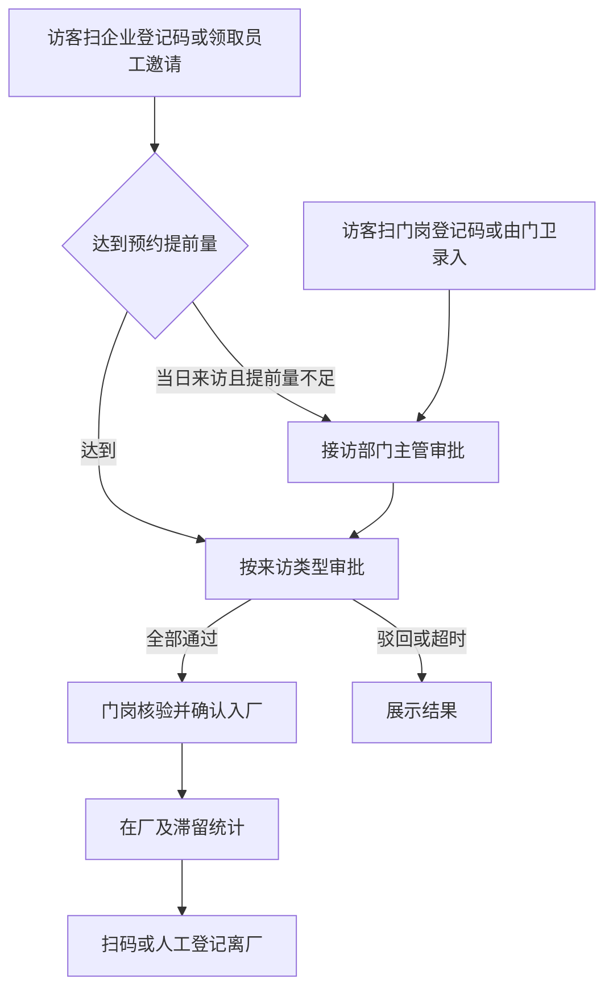

# 入厂登记管理系统需求文档

配套文档 [开发设计](visitor-management-design.md)

## 1. 产品范围

系统服务于单家企业的一个或多个厂区。访客扫码打开公网手机登记页，员工、审批人、门卫和管理人员登录公网工作台。内部账号由本系统维护。审批通过且门岗核验成功后，系统登记入厂，由门卫现场放行。系统记录人员与车辆进出厂、在厂及超时情况，并提供安全管理、统计和导出。

首版按一人一申请、一次访问一进一出设计。同行人员各自登记，由当次驾驶人关联车辆。同一厂区的授权门岗可办理离厂。跨厂区访问分别申请。

## 2. 角色与权限

| 角色 | 工作内容 | 数据范围 |
| --- | --- | --- |
| 外来访客 | 扫码登记、自助预约、接受邀请、查看进度、出示入厂码与离厂码 | 本人提交或核验后领取的申请 |
| 员工 | 邀请访客、查看和撤销本人发出的未入厂邀请、跟进审批 | 本人邀请及所属授权范围 |
| 老板或获授权代理 | 确认客户来访 | 已分配的客户审批 |
| 部门主管及部门审批人 | 根据岗位确认对应人员申请，接待部门主管确认现场来访 | 具有审批授权的厂区、部门与审批岗位 |
| 门卫保安 | 扫码入厂与离厂、现场与车辆登记、身份核验、查看在厂人员 | 授权厂区及门岗，可查询本厂区在厂人员 |
| 行政人员 | 维护预约规则、来访类型、访客档案、厂区与门岗，按授权查询记录 | 授权厂区 |
| 安全管理人员 | 安全审核、培训和施工许可核实、黑名单、访问区域、安全须知、告警与记录更正审批 | 授权厂区。具备全局授权时可管理全厂区名单 |
| 公司管理层 | 查看汇总看板、统计及获授权的历史导出 | 授权厂区或企业汇总 |
| 系统管理员 | 用户、角色、部门、权限及操作日志 | 系统管理，访客明细依业务权限单独分配 |

## 3. 来访类型与审批要求

| 人员类型 | 按类型审批 | 申请及核验重点 |
| --- | --- | --- |
| 客户 | 老板或已授权的代理确认 | 指定接待人员和访问区域 |
| 供应商 | 采购部门确认 | 来访事由 |
| 送货司机 | 仓库或采购部门任意一方确认 | 车牌、送货单号 |
| 物流司机 | 物流部门确认 | 车牌、提货单号 |
| 外协施工人员 | 负责部门先审批，安全部门再审批 | 安全部门核实培训、施工许可、有效期和作业区域 |
| 设备维修人员 | 设备部门确认 | 维修工单、作业区域 |
| 面试人员 | 人事部门确认 | 面试日期和时间 |
| 软件维护人员 | 信息化部门确认 | 维护工单或变更单号、维护时间窗口、获准作业区域 |

**现场来源统一增加接访部门主管审批。** 先由接访部门主管确认接待，再处理按类型要求的审批。主管同时具备该申请对应的类型审批权限时，可用一次操作完成两项，审批记录分别保留。外协施工的安全审批始终由另一名有安全授权的人员独立完成。

### 预约授权条件

1. 自助预约与员工邀请统一按类型人工审批。预约以访客完成提交的服务器时间为准，默认须提前至少 2 小时，默认可提交未来 30 天内的来访。两个参数由行政按厂区调整。允许入厂的时段和最大停留时间由厂区配置。
2. 扫门岗现场登记码、门卫代登记，或距计划到厂不足提前量的当日申请，均进入现场审批。页面在提交前明确显示“现场登记”及需要等待审批。自助预约的被访人姓名选填，由门岗或行政在内部确认接访部门，之后按类型审批。
3. 申请资料齐全且审批全部通过后，获得指定厂区、允许入厂时段和获准区域的通行资格。所有现场申请须在厂区设定的等待时限内完成审批并入厂，默认 60 分钟，且受计划离厂时间限制。截止后须重新提交。
4. 员工发起邀请时填写受邀人、手机号、接待人、时间和事由。访客核验受邀手机号并补齐资料后，进入相同审批规则。邀请人可撤回尚未提交的邀请，或撤销该邀请产生的未入厂申请。邀请创建、审批和门岗放行分别留痕。
5. 批准后如变更访客、类型、厂区、接访部门或人员、时间、车辆、业务单号或适用区域，重新进入审批，原通行码失效。未入厂的申请可撤销。审批规则发布后应用于后续提交，名单、临时禁入和停用区域在入厂确认时实时校验。
6. 审批人缺失时，申请保留为待审批并提醒行政补配授权。驳回应填写理由，访客可查看可公开的处理结果。黑名单及内部处置细节仅向授权人员展示。

## 4. 登记入口与界面

### 访客手机页

企业登记码打开对应厂区的登记表。门岗现场登记码打开同一表单并预选厂区及现场来源。员工邀请链接预填已指定信息。

| 表单区域 | 设计 |
| --- | --- |
| 基础信息 | 扫码后直接填写姓名、手机号码、所属公司或机构、来访类型、被访人员、来访日期、来访事由。手机号码仅用于联系 |
| 被访人员 | 选填纯文本姓名，允许留空。外部页面与接口提供访客本人填写的内容，内部人员、部门及区域资料由授权员工在工作台管理 |
| 车辆信息 | 是否驾车。选择“是”才填写车牌。司机类型默认驾车，并展示对应的送货单号或提货单号 |
| 分类信息 | 按来访类型补充面试时间、工单等来访资料。访问区域由门岗或行政在内部指定，安全部门核实培训及许可 |
| 须知与提交 | 分别勾选“已阅读入厂安全须知”和“已阅读个人信息处理说明”。系统记录文档版本、确认时间和渠道 |
| 申请结果 | 在提交预约的浏览器中查看待审批、获准、驳回、撤销、失效及在厂状态。获准后在可入厂时段显示入厂码，在厂期间显示离厂码与应离厂时间，门岗核对获准区域后提供现场指引 |

证件信息在门岗首次核验时采集。面试人员等无所属公司的访客可选择“个人”。现场无手机访客由门卫代登记，门卫提供须知与信息处理说明后记录本人的阅读确认。

### 门卫工作台

顶部展示当前厂区、门岗与四张卡片 **今日预约、已入厂、已离厂、当前在厂**。中部设置四个常驻大按钮 **扫码入厂、扫码离厂、现场登记、车辆登记**。下方列出姓名、来访公司、被访人、最近事件时间和状态，可按姓名、车牌或单号搜索。

- **已预约司机**。点击“扫码入厂”，扫码卡片直接显示姓名、被访部门、车牌和业务单号。门卫核对后点击“确认入厂”。已核验并绑定的访客可复核脱敏证件信息，首次来访补录核验所需证件数据。
- **未预约司机**。点击“车辆登记”，选择“送货”或“提货”。表单预填厂区、门岗和当日时间，集中填写访客、接访对象、车牌及对应单号。提交后停留在结果页查看审批状态，通过后原位确认入厂。
- **普通现场来访**。点击“现场登记”后按类型填写。门岗可通过“待审批、待入厂、在厂”查看后续可办理事项。状态使用文字和颜色，主按钮只显示当前可执行的步骤。
- **扫码离厂**。扫描访客离厂码，门卫核对人员及随行车辆并确认离厂。无手机、无摄像头或码已过期时可查找在厂记录人工办理。

## 5. 功能导航

| 一级菜单 | 二级功能 |
| --- | --- |
| 首页工作台 | 今日入厂人数、今日离厂人数、当前在厂人数、异常滞留人数 |
| 预约管理 | 访客自主预约、员工邀请访客、现场登记、预约记录 |
| 审批管理 | 待审批申请、已审批申请、审批规则配置 |
| 门卫管理 | 扫码入厂、扫码离厂、身份核验、在厂人员查询。门岗工作台常驻现场登记和车辆登记入口 |
| 安全管理 | 黑名单、超时滞留预警、其他异常、访问区域管理、安全须知、补录与更正审核 |
| 数据统计 | 来访人员统计、来访部门统计、车辆统计、历史记录导出 |
| 系统管理 | 用户管理、部门管理、角色管理、权限管理、厂区与门岗管理、操作日志 |
| 二维码管理 | 管理指定厂区的访客预约码与门岗现场登记码，支持生成、预览、下载、复制链接和启停 |

### 核验、预警与追溯

- 门岗在确认入厂时复核身份、审批、时间、厂区、门岗、区域、车辆、适用安全条件、当前黑名单和重复入厂。现场已批准的登记单、有效的入厂码、人工检索到的已批准申请使用同一套核验条件。
- 安全管理人员按证件身份维护有起止时间及适用厂区的黑名单。黑名单命中时拦截入厂并生成预警。新增名单命中在厂人员时提醒安全人员。入厂后被列入名单、滞留或入厂码已失效的访客仍可登记离厂。
- 应离厂时间取审批时约定的离厂时间、厂区停留上限换算出的时间，以及适用的作业许可结束时间中的最早值。到达该时刻仍在厂则计入异常滞留。预警在安全工作台认领并结案，更新在厂状态时保留处置历史。
- 核验失败、证件不符、重复入厂、车牌不符及无法找到入厂记录的离厂尝试进入核实流程。门卫或行政可提出补录或更正，由安全人员核准。时间线保留原事件、实际发生时间、补录时间和操作者。
- 普通流程由门卫同时确认驾驶员及车辆进出厂。换驾驶员或人员、车辆分开出厂时，按实际进出分别提交安全核准补录。
- 网络不可用时门岗提示无法核验。连接恢复后重试入厂操作。实际离厂可先按现场制度记下，恢复后走补录。

### 统计与导出

| 指标 | 定义 |
| --- | --- |
| 今日预约 | 计划到厂日为今日的有效申请数，含三种登记来源，排除已撤销、已驳回及失效申请 |
| 今日入厂／离厂人数 | 分别按实际有效入厂／离厂事件所在厂区自然日统计人次。跨午夜的离厂计入新一天 |
| 当前在厂人数 | 当前有有效入厂且尚未离厂的人数，覆盖跨日访客 |
| 异常滞留人数 | 当前在厂且已到达应离厂时间的人数 |
| 访问与部门统计 | 按日期、厂区、访客类型、来源、接访部门汇总预约、入厂及离厂人次 |
| 车辆统计 | 按车辆实际进出事件统计车次，支持按厂区、类型及车牌筛选。同车乘客的人次单独统计 |
| 历史导出 | 依据当前筛选和权限导出访问、车辆或异常记录，默认脱敏，审计下载人和筛选条件 |

## 6. 验收场景

| 编号 | 场景 | 预期结果 |
| --- | --- | --- |
| R01 | 扫企业登记码，自助预约供应商来访 | 填写手机号码并确认须知后直接提交，采购确认后在提交预约的浏览器中出示入厂码 |
| R02 | 扫门岗登记码或提交到达时间不足 2 小时的当日申请 | 归类为现场登记，接访主管与类型审批齐备后才可确认入厂 |
| R03 | 员工邀请客户，非受邀手机号打开链接 | 无法领取邀请。受邀人验证后补齐资料，由老板或代理确认 |
| R04 | 送货由仓库确认；物流提货由采购尝试确认 | 前者满足送货审批要求，后者仍由物流部门处理 |
| R05 | 外协施工只有负责部门批准或许可已过期 | 系统保持待审批或拦截入厂，安全审批且培训、许可有效后方可放行 |
| R06 | 软件维护、面试及设备维修分别提交 | 各自进入信息化、人事及设备部门审批，按类型提示必填项 |
| R07 | 门卫登记无手机司机，随后办理入厂与离厂 | 车辆登记页可填写车牌与单号，原位查看审批，获准后可人工办理进出厂 |
| R08 | 已核验人员持码进出；错扫入厂与离厂码或重复提交 | 门岗提示正确操作。每次访问只生成一次有效入厂和离厂，重复请求显示原结果 |
| R09 | 扫码后批准被撤销，或访客被加入黑名单 | 确认入厂被拦截。黑名单命中进入安全预警 |
| R10 | 携车跨午夜滞留，次日从另一授权门岗离厂 | 次日离厂车次与人次正确，离厂后在厂及滞留扣减，预警可追溯 |
| R11 | 审批人、访客或门卫访问授权范围外的详情或导出 | 数据拒绝访问，导出只包含可见范围并留审计记录 |
| R12 | 未参与培训的门卫首次办理已预约和未预约的司机来访 | 能从工作台独立找到入口、完成核验或录入、查看审批状态及登记离厂 |
| R13 | 获准后修改车牌或作业区域，或邀请人撤销未入厂申请 | 旧码失效。修改后重新审批，撤销后门岗可看到撤销状态 |

## 7. 上线配置

需录入真实的厂区、门岗、工作时段、部门及审批人，指定老板代理与安全审批岗位，确认首版安全须知、个人信息处理说明和数据保留期限。开通访客短信服务后，使用实际访客手机和门岗终端完成扫码验收。
